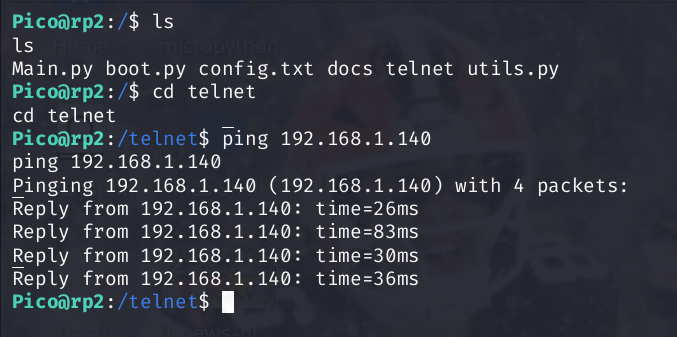

# PicoShell

**PicoShell** is a lightweight UNIX-style command shell for the **Raspberry Pi Pico 2 W (RP2350)** written in MicroPython. It provides filesystem tools, Wi-Fi/network utilities, Telnet access, Bluetooth LE tools, script execution, GPIO/I2C controls, system monitoring, CPU clock control, and a built-in self-updater.



## Features

- Interactive shell over USB serial or Telnet
- Headless operation with automatic Telnet startup after Wi-Fi connects
- Automatic fallback access point when the configured Wi-Fi is unavailable
- Wi-Fi credential setup over Telnet from a phone or laptop
- Bluetooth LE scanning, connecting, GATT discovery, reads, and writes
- Fixed-size BLE scan cache to avoid unbounded heap growth
- Viper-accelerated BLE advertising-field parsing
- Persistent Wi-Fi/Telnet/AP configuration through `config.txt`
- Filesystem navigation and file manipulation
- Python script execution from Pico storage
- HTTP/HTTPS file download and basic network tools
- TCP port scanning
- GPIO read/write/mode control
- I2C bus scanning
- RAM, storage, uptime, temperature, and CPU clock information
- RP2350 CPU clock adjustment from the shell
- Transactional self-update system using GitHub
- `Ctrl+C` / `exit` support to return to the MicroPython REPL for Thonny
- USB-safe boot flow: `boot.py` no longer takes ownership of the REPL or manually imports `main.py`

## Commands

### General

| Command | Description |
|---|---|
| `help`, `h` | Show PicoShell help |
| `about` | Show PicoShell version and platform info |
| `version` | Show installed PicoShell version |
| `uptime` | Show time since PicoShell started |
| `clear` | Clear the terminal |
| `exit` | Leave PicoShell and return to the MicroPython REPL |
| `reboot` | Hard reset the Pico |
| `reset` | Soft reset MicroPython |

### Filesystem

| Command | Description |
|---|---|
| `pwd` | Print current working directory |
| `ls [path]` | List files and directories |
| `cd <dir>` | Change directory |
| `mkdir <dir>` | Create a directory |
| `rmdir <dir>` | Remove an empty directory |
| `rm <file>` | Delete a file |
| `read <file>` | Print a text file |
| `cp <src> <dst>` | Copy a file |
| `mv <src> <dst>` | Move or rename a file |
| `touch <file>` | Create a file if it does not exist |
| `tree [path] [depth]` | Recursively display a directory tree |
| `write <file> <text>` | Overwrite a file with text |
| `append <file> <text>` | Append a line of text to a file |

### Networking / Telnet

| Command | Description |
|---|---|
| `wifi` | Scan/connect to Wi-Fi or disconnect from the current network |
| `wifi setup` | Save a new SSID/password to `config.txt` for the next reboot |
| `ifconfig` | Show station and active access-point network configuration |
| `scan` | Scan nearby Wi-Fi networks |
| `ping <host>` | TCP-connect reachability/latency test using port 80 |
| `curl <url>` | Fetch and display content from a URL |
| `clone <url> [name]` | Download a file over HTTPS; raw GitHub URLs are supported |
| `pmap <host> [start] [end]` | Scan a TCP port range; default is 1-1024 |
| `telnet launch` | Start the Telnet server |
| `telnet stop` | Stop the Telnet server |

> `ping` is currently a TCP connection timing test, not an ICMP echo implementation.

### Bluetooth LE

| Command | Description |
|---|---|
| `ble scan [seconds]` | Scan for nearby BLE devices; default 5 s, maximum 30 s |
| `ble devices` | Show cached BLE scan results and device indexes |
| `ble connect <index>` | Connect to a device from the latest scan |
| `ble disconnect` | Disconnect the current BLE peripheral |
| `ble status` | Show BLE state, local address, connection and RAM |
| `ble services` | Discover GATT services on the connected device |
| `ble chars <service_index>` | Discover characteristics in one service |
| `ble read <value_handle>` | Read a characteristic or descriptor |
| `ble write <value_handle> <text>` | Write UTF-8 text with response |
| `ble writehex <value_handle> <hex>` | Write raw hexadecimal bytes with response |
| `ble on` / `ble off` | Enable or disable the BLE radio |

BLE scanning uses MicroPython's native Bluetooth stack. The advertising-data field walker is implemented with `@micropython.viper`, because that hot path is a tight byte-buffer parser. Scan results are capped at 24 devices to avoid unbounded allocations during long or busy scans.

### Scripts

| Command | Description |
|---|---|
| `run <file.py>` | Execute a Python script from Pico storage |

### System

| Command | Description |
|---|---|
| `sysinfo` | Show MicroPython/system information |
| `dspace` | Show flash storage usage |
| `ram` | Show RAM usage |
| `freemem` | Run garbage collection and show memory before/after |
| `clock` | Show current CPU clock speed |
| `setclock <MHz>` | Set CPU frequency; PicoShell currently allows >40 MHz and <260 MHz |
| `temp` | Show the current temperature reading |
| `blink [times] [delay]` | Blink the onboard LED |

### GPIO / I2C

| Command | Description |
|---|---|
| `gpio read <pin>` | Read a GPIO pin |
| `gpio write <pin> <0\|1>` | Drive a GPIO pin low or high |
| `gpio mode <pin> <in\|out\|pullup\|pulldown>` | Configure a GPIO pin |
| `i2c scan <bus> <sda> <scl> [freq]` | Scan an I2C bus for connected devices |

Example:

```text
gpio mode 15 out
gpio write 15 1
gpio read 15
i2c scan 0 0 1 400000
```

## Configuration

Create `config.txt` in the Pico root directory:

```text
SSID=Your WiFi Name
PASSWORD=YourPassword
TELNET_AUTO=1
AP_FALLBACK=1
AP_PASSWORD=picoshell
```

`TELNET_AUTO=1` starts the Telnet listener automatically after Wi-Fi connects, which allows the Pico to run headless with only power connected. Set it to `0` if you want Telnet to remain off until `telnet launch` is entered manually.

`AP_FALLBACK=1` enables the lightweight recovery/setup access point. `AP_PASSWORD` sets its WPA2 password and must be 8-63 characters.

Existing configurations without the AP options remain compatible. PicoShell defaults to AP fallback enabled with the password `picoshell`.

The SSID may contain spaces. Do not wrap the SSID or password in quotes. The Pico 2 W uses 2.4 GHz Wi-Fi.

## Fallback AP setup

If `config.txt` has no SSID, is missing, or the Pico cannot join the saved network within about 13 seconds, PicoShell disables the failed station connection and creates its own WPA2 access point.

The SSID is generated from the device ID so nearby PicoShell devices can be distinguished:

```text
PicoShell-XXXXXX
```

With the default configuration:

```text
Password: picoshell
IP:       192.168.4.1
Telnet:   TCP/23
```

Connect a phone or laptop to the PicoShell SSID, then Telnet to `192.168.4.1`. From PicoShell run:

```text
wifi setup
```

Enter the real Wi-Fi SSID and password when prompted, then:

```text
reboot
```

PicoShell will try the saved network on the next boot. If the credentials or network are still unavailable, the fallback AP returns so the board is not stranded.

Telnet is plaintext. The fallback AP itself uses WPA2, but do not expose TCP/23 directly to the public internet.

## Self-update

| Command | Description |
|---|---|
| `update check` | Compare the installed version against `version.txt` on GitHub |
| `update install` | Download and install a newer version, then reboot |

`version.txt` is the single source of truth for the installed PicoShell version.

The updater stages all new files as `.new`, backs up the installed copies as `.bak`, and swaps them only after every download succeeds. Current update targets are:

```text
main.py
utils.py
boot.py
ble_cli.py
telnet/utelnetserver.py
docs/help.txt
version.txt
```

`config.txt` is intentionally **not** updated so an OTA update cannot overwrite Wi-Fi credentials or local settings. Existing installations therefore get the fallback AP defaults even if their older `config.txt` does not contain the new AP keys.

### Upgrading from v0.2.0

The v0.2.0 updater did not include `boot.py` in its update list. v0.2.1 includes a startup migration that replaces the older REPL-binding `boot.py` with a minimal USB-safe file. Future updates also update `boot.py` directly.

### Upgrading from v0.3.1

The v0.3.1 updater predates `ble_cli.py`, so it cannot download that new file during the initial 0.3.2 update. After the updated `main.py` reconnects to Wi-Fi, it automatically fetches `ble_cli.py` once. From that point onward the normal updater includes the BLE module.

## Boot / USB behavior

`boot.py` is intentionally minimal. MicroPython initializes the built-in USB REPL and automatically runs `main.py` after `boot.py`; PicoShell does not need to bind `sys.stdin` with `dupterm()` or manually `import main` from `boot.py`.

If PicoShell is running and Thonny needs the raw REPL, press **Ctrl+C** or enter:

```text
exit
```

## Project Structure

```text
boot.py                  # Minimal USB-safe boot script
main.py                  # CLI, command handlers, Wi-Fi/AP/Telnet startup
ble_cli.py               # Lazy-loaded BLE central/scanner/GATT CLI tools
utils.py                 # Filesystem, networking, GPIO/I2C, updater, and system helpers
config.txt               # Wi-Fi, Telnet, and AP fallback settings
docs/
  help.txt               # Built-in help text
telnet/
  utelnetserver.py       # Lightweight Telnet server
version.txt              # Installed PicoShell version (single source of truth)
pico-shell.png           # README screenshot
```

## Getting Started

PicoShell targets the **Raspberry Pi Pico 2 W**.

1. Flash the current Pico 2 W MicroPython UF2.
2. Copy `boot.py`, `main.py`, `ble_cli.py`, `utils.py`, `config.txt`, `version.txt`, `docs/`, and `telnet/` to the Pico filesystem.
3. Either fill in `config.txt` before boot or leave `SSID` blank to use fallback AP setup.
4. Reset the Pico.
5. With valid credentials, PicoShell joins Wi-Fi and starts Telnet. Otherwise it broadcasts a `PicoShell-XXXXXX` setup network.

Example prompt:

```text
Pico@rp2:/$
```

For a headless installation, power the Pico normally and connect to TCP port 23 after it joins Wi-Fi, or use the fallback AP directly from a phone/laptop.

## v0.2.1 changes

- Replaced the old REPL-binding `boot.py` with a minimal USB-safe boot file.
- Added automatic Telnet startup for headless use, controlled with `TELNET_AUTO` in `config.txt`.
- Made `version.txt` the single source of truth for the installed version.
- Added `boot.py` to the OTA update set so future boot-script fixes can be delivered remotely.
- Preserved `config.txt` during OTA updates so local Wi-Fi credentials and settings are not overwritten.

## v0.2.2 changes

- Added Telnet ECHO / SUPPRESS-GO-AHEAD negotiation so clients do not locally echo commands a second time.
- Improved Telnet control-sequence parsing so negotiation bytes do not leak into shell input.
- Added `telnet/utelnetserver.py` to the OTA update set.
- Added a one-time v0.2.1 migration so existing boards can fetch the new Telnet server even though the older updater did not include it.

## v0.3.0 changes

- Added automatic WPA2 fallback AP mode when saved Wi-Fi cannot be reached.
- Added a unique `PicoShell-XXXXXX` setup SSID and fixed setup IP `192.168.4.1`.
- Added `wifi setup` to save new Wi-Fi credentials from a Telnet session.
- Added `AP_FALLBACK` and `AP_PASSWORD` configuration options.
- Extended `ifconfig` to show the active AP interface.

## v0.3.1 changes

- Reworked Telnet receive buffering to reuse a fixed 32-byte `bytearray` instead of allocating a new `bytes` object for each socket receive.
- Removed per-character receive-buffer slicing to reduce heap churn and fragmentation during interactive sessions.
- Reduced normal-path Telnet write allocations by only slicing after an actual partial socket write.
- Added garbage collection after listener setup and before replacement client sessions while keeping the listener active for recovery/reconnects.
- Preserved the existing listener behavior; v0.3.1 does not trade reconnectability for lower RAM usage.

## v0.3.2 changes

- Added core Bluetooth LE CLI support for scanning and connecting to peripherals.
- Added GATT service/characteristic discovery plus read and write commands.
- Added a fixed 24-device BLE scan cache to limit heap growth.
- Added Viper-accelerated advertising-data field parsing.
- Added `ble on` / `ble off` and BLE memory/status reporting.
- Added one-time automatic `ble_cli.py` bootstrap for boards upgrading from v0.3.1.

## Version

Current version: **0.3.2**

## License

MIT License. See [LICENSE](LICENSE).
